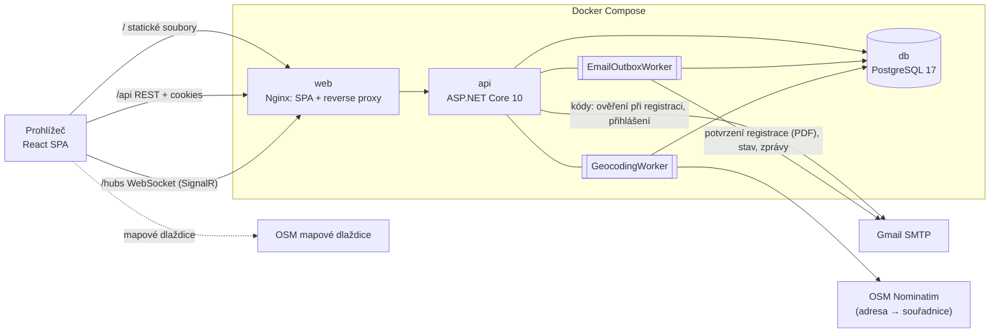
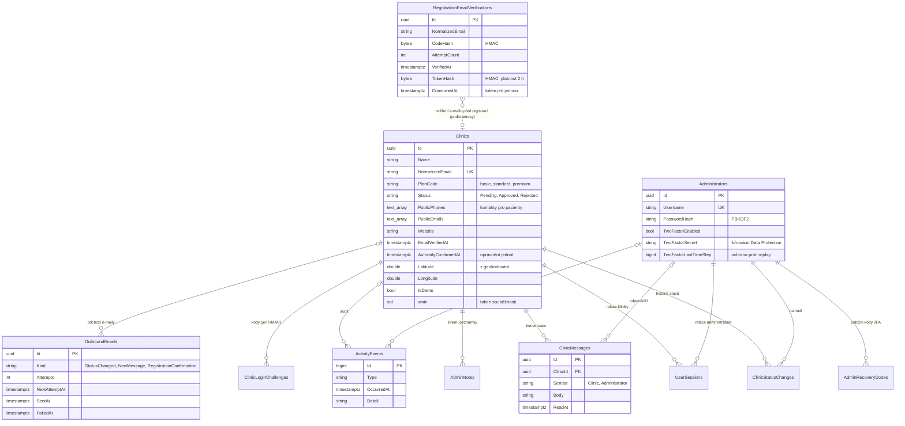
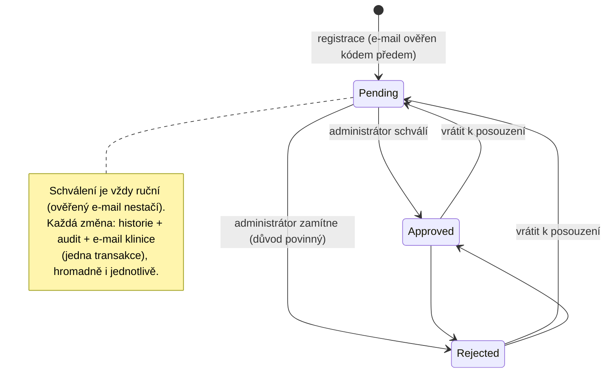
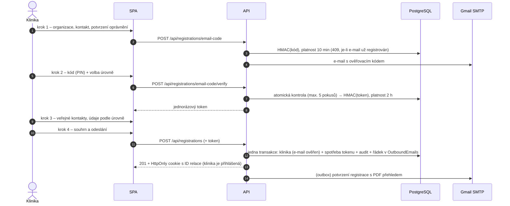
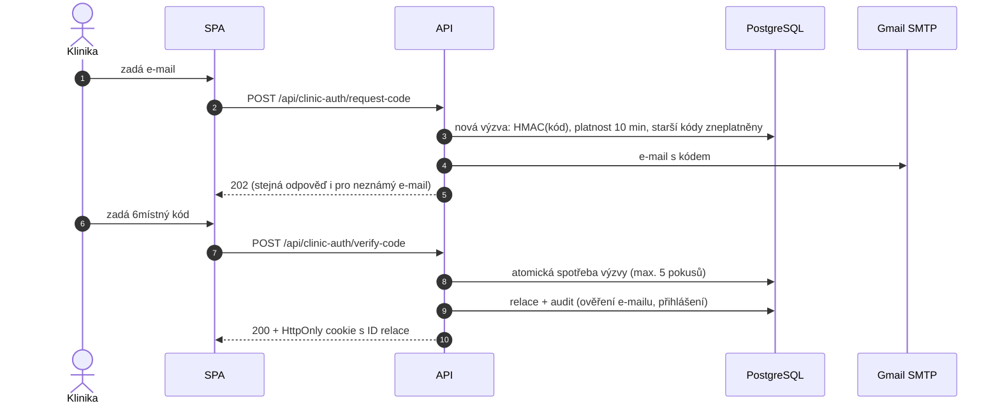
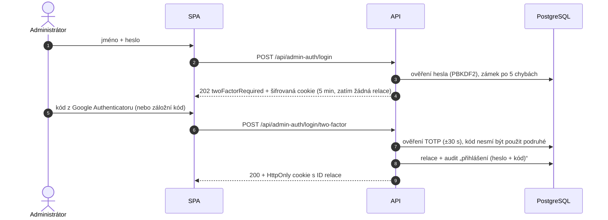
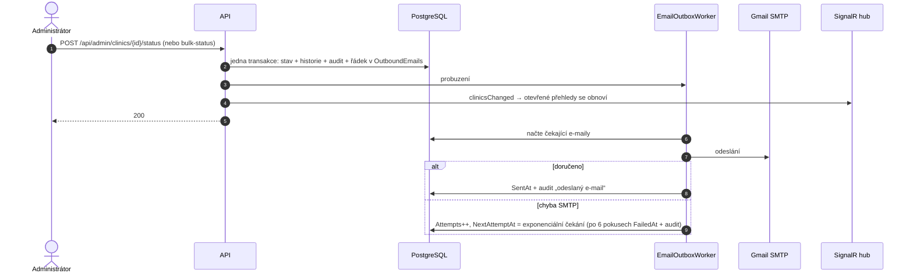

# ApolloData – registrační portál očních klinik

[](https://github.com/toyotomicz/ApolloOcniKliniky/actions/workflows/ci.yml)

Full-stack webová aplikace pro registraci **očních klinik**. Klinika se na veřejné stránce zaregistruje ve čtyřech
krocích (kontakt a organizace → ověření e-mailu kódem a volba úrovně → veřejné kontakty pro pacienty → souhrn
a odeslání), dostane potvrzení s PDF přehledem, přihlašuje se jednorázovým kódem z e-mailu (bez hesla) a v portálu
sleduje stav registrace, komunikuje s administrátorem a stahuje potvrzení v PDF. Administrátor registrace posuzuje – jednotlivě i hromadně – a má
k dispozici přehled se statistikami, mapu klinik, audit log s exportem, notifikace v reálném čase a dvoufázové
přihlášení přes Google Authenticator.

Vzhled (barvy, písma) je sladěný s webem [apollodata.cz](https://www.apollodata.cz/).

| | |
|---|---|
| **Produkční instance** | https://aether223.zcu.cz (administrace: `/admin`) |
| **Repozitář** | https://github.com/toyotomicz/ApolloOcniKliniky (soukromý) |
| **Technologie** | .NET 10 · ASP.NET Core · EF Core · PostgreSQL 17 · React 19 · TypeScript · Vite · Docker |

> **Nezávislý projekt.** Nejde o oficiální službu ani integraci VZP či jiné instituce. Obsah úrovní registrace
> (texty a ceny) je provizorní. Aplikace nezpracovává žádné údaje o pacientech.

---

## Obsah

1. [Funkce](#funkce)
2. [Architektura](#architektura)
3. [Lokální spuštění (Docker)](#lokální-spuštění-docker)
4. [Nasazení na server](#nasazení-na-server)
5. [Konfigurace (.env)](#konfigurace-env)
6. [E-mail (Gmail)](#e-mail-gmail)
7. [Administrátor a dvoufázové ověření](#administrátor-a-dvoufázové-ověření)
8. [Demo data](#demo-data)
9. [Ukázkový scénář](#ukázkový-scénář)
10. [Vývoj bez Dockeru](#vývoj-bez-dockeru)
11. [Databáze a migrace](#databáze-a-migrace)
12. [Testy a CI](#testy-a-ci)
13. [API](#api)
14. [Bezpečnost](#bezpečnost)
15. [Předpoklady a omezení](#předpoklady-a-omezení)
16. [Řešení problémů](#řešení-problémů)

---

## Funkce

### Pro kliniky

- **Úvodní stránka** se sekcí „Jak to funguje“ a třemi úrovněmi registrace (Úroveň 1 / 2 / 3; interně
  `basic` / `standard` / `premium`) a decentními animacemi.
- **Registrace ve čtyřech krocích** (přesně podle sekce „Jak to funguje“):
  1. **Kontakt a organizace** – název, IČO (kontrolní součet), e-mail, kontaktní osoba, adresa a povinné potvrzení
     **oprávnění jednat jménem organizace**.
  2. **Ověření e-mailu a úroveň** – na e-mail přijde ověřovací kód (PIN) ještě **před** vznikem registrace;
     po ověření se volí úroveň (karty s cenou).
  3. **Veřejné kontakty** – až 3 telefony a 3 e-maily pro objednání pacientů (alespoň jeden je povinný), web
     a další informace; úroveň 2 přidává provozní kontakt, úroveň 3 navíc konfiguraci služby.
  4. **Souhrn a odeslání** – po odeslání je klinika rovnou přihlášená a přijde jí **potvrzení s PDF přehledem**.
  Validace na klientu i serveru.
- **Přihlášení bez hesla** – šestimístný jednorázový kód z e-mailu.
- **Portál kliniky** – stav a průběh registrace, zpráva/důvod od administrátora, úprava kontaktních údajů
  včetně veřejných kontaktů, **zprávy s administrátorem** a **potvrzení o registraci v PDF**.
- **E-maily** – ověřovací kód při registraci, potvrzení registrace s PDF, přihlašovací kód, oznámení o schválení /
  zamítnutí / vrácení k posouzení (s důvodem) a upozornění na novou zprávu od administrátora.

### Pro administrátory

- **Přehled** – metriky (registrace, nové dnes, čekající, schválené, zamítnuté, nepřečtené zprávy, průměrná doba
  do rozhodnutí, míra schválení, přihlášené kliniky dnes), graf registrací za 7 / 30 dní, průchod registrací
  (registrace → ověřený e-mail → schválení), rozdělení podle úrovní a poslední aktivita.
- **Kliniky** – vyhledávání (název, e-mail, město, IČO), filtry podle stavu, úrovně a nepřečtených zpráv, řazení,
  stránkování a **hromadné akce** (schválit / zamítnout / vrátit k posouzení / smazat vybrané kliniky v jedné transakci).
- **Detail kliniky** – všechny údaje (včetně kontaktů pro pacienty a potvrzeného oprávnění jednat), rozhodnutí s potvrzením (zamítnutí vyžaduje důvod), historie stavů,
  interní poznámky, **konverzace s klinikou**, mapa polohy (lze zvětšit), PDF potvrzení, odkaz do audit logu
  a **trvalé smazání kliniky** (s potvrzením; v audit logu zůstane záznam „Smazání kliniky“).
- **Mapa klinik** – OpenStreetMap, barva značky podle stavu, filtry, proklik na detail, zvětšení na celou obrazovku.
  Polohu z adresy dohledává proces na pozadí.
- **Notifikace v reálném čase** (SignalR přes WebSocket) – nová registrace nebo zpráva se okamžitě ohlásí
  a otevřené přehledy se samy obnoví. Stav spojení ukazuje indikátor „Živě“ v horní liště.
- **Audit log** – kdo, kdy a co udělal (registrace, přihlášení včetně neúspěšných, změny stavu, zprávy, odeslané
  e-maily, exporty…), filtry a **export do CSV** pro Excel.
- **Zabezpečení** – **dvoufázové ověření přes Google Authenticator** (QR kód, záložní kódy).

---

## Architektura



| Vrstva | Technologie |
|---|---|
| Frontend | React 19, TypeScript (strict), Vite 8, React Router 8, React Hook Form + Zod, Lucide ikony, Leaflet (mapa), `@microsoft/signalr`; vlastní CSS bez UI knihoven – barvy `#313336` / `#c93a32`, písma Open Sans, Saira a Nunito (self-hosted) |
| Backend | ASP.NET Core Minimal API (.NET 10), EF Core 10 + Npgsql, MailKit, SignalR, QuestPDF, Otp.NET + QRCoder, ASP.NET Core Identity `PasswordHasher`, Data Protection, rate limiting, antiforgery |
| Databáze | PostgreSQL 17, migrace EF Core |
| Testy | xUnit v3 + Testcontainers (skutečný PostgreSQL), Vitest + React Testing Library, GitHub Actions |
| Provoz | Docker Compose (`db`, `api`, `web`), Nginx (statické soubory, proxy `/api` a `/hubs`, bezpečnostní hlavičky) |

### Struktura repozitáře

```
apollo/
├─ .github/workflows/ci.yml   automatické testy na GitHubu
├─ backend/
│  ├─ src/ApolloData.Api/
│  │  ├─ Domain/          entity (Clinic, ClinicMessage, OutboundEmail, Administrator, ActivityEvent, …)
│  │  ├─ Data/            DbContext, Fluent API konfigurace, migrace, zápis do audit logu
│  │  ├─ Plans/           PlanCatalog – jediný zdroj definic úrovní registrace
│  │  ├─ Clinics/         registrace, portál kliniky, validace, DTO
│  │  ├─ Messages/        konverzace klinika ↔ administrátor
│  │  ├─ Auth/            jednorázové kódy (přihlášení i ověření e-mailu při registraci), relace, 2FA, účty administrátorů
│  │  ├─ Admin/           přehled, seznam/detail, změny stavu, hromadné akce, audit log + CSV
│  │  ├─ Realtime/        SignalR hub a notifikace pro administrátory
│  │  ├─ Documents/       PDF potvrzení (QuestPDF)
│  │  ├─ Geo/             geokódování adres na pozadí (Nominatim)
│  │  ├─ Email/           odesílání (MailKit), HTML šablony, transakční outbox + worker
│  │  ├─ Common/          validace, ProblemDetails, AppInfo
│  │  └─ Hosting/         registrace služeb, pipeline, CSRF, údržbové příkazy, demo data
│  └─ tests/ApolloData.Api.Tests/   integrační a jednotkové testy
├─ frontend/
│  ├─ src/{api,admin,auth,components,layouts,pages,lib,styles,config}
│  └─ nginx/              konfigurace Nginx
├─ scripts/               init-env, deploy, seed-demo, reset-admin, reset-admin-2fa, run-api-local
├─ docker-compose.yml     celý stack
├─ docker-compose.dev.yml publikuje DB na localhost pro vývoj bez Dockeru
└─ .env.example           šablona konfigurace (jen zástupné hodnoty)
```

### Klíčová rozhodnutí

- **Úrovně registrace na jednom místě** – `Plans/PlanCatalog.cs`. Frontend z `GET /api/plans` vykresluje karty
  i pole podle úrovně, backend podle stejného katalogu validuje. Zobrazované názvy jsou „Úroveň 1–3“, interní
  kódy `basic` / `standard` / `premium` se nemění.
- **E-mail ověřený před registrací** – `POST /api/registrations/email-code` pošle kód, `…/verify` ho vymění za
  jednorázový token (platí 2 h, v databázi jen HMAC) a `POST /api/registrations` bez platného tokenu pro stejnou
  adresu neprojde. Registrace tak vzniká rovnou s ověřeným e-mailem a klinika je po odeslání přihlášená.
- **Serverové relace** – HttpOnly cookie nese jen ID relace, která se při každém požadavku ověřuje v databázi,
  takže odhlášení a odvolání platí okamžitě. Klinika a administrátor mají oddělená cookie schémata.
- **Žádná ID v URL kliniky** – endpointy kliniky určují kliniku vždy ze serverové relace, klinika tedy nemůže
  adresovat cizí data.
- **Transakční outbox pro e-maily** – e-mail o změně stavu i potvrzení registrace se zapíše do tabulky
  `OutboundEmails` ve stejné transakci jako změna; odešle ho worker na pozadí a při chybě opakuje. Výpadek Gmailu
  nic neztratí. PDF přílohu potvrzení vygeneruje worker až při odeslání (v databázi se neukládá).
- **Realtime jen jako signál** – SignalR posílá jen „něco se změnilo“; data se vždy načítají přes REST API
  se stejnou autorizací.
- **Audit log jako jediný zdroj historie** – všechny akce (i systémové) se zapisují do `ActivityEvents`;
  z něj čerpá přehled, metrika přihlášení i stahovatelný audit log.

### Model dat



### Stavy registrace



### Registrace kliniky



### Přihlášení kliniky kódem z e-mailu



### Přihlášení administrátora s dvoufázovým ověřením



### Změna stavu → e-mail a notifikace



---

## Lokální spuštění (Docker)

Předpoklady: Windows 10/11 s **Docker Desktop** (WSL 2) a aspoň **5 GB volného místa** na disku pro sestavení obrazů.

1. Vytvořte konfiguraci – skript zkopíruje `.env.example` do `.env` a vygeneruje náhodná hesla
   (`POSTGRES_PASSWORD`, `ADMIN_PASSWORD`, `OTP_HASH_KEY`):
   ```bash
   powershell -ExecutionPolicy Bypass -File scripts/init-env.ps1
   ```
2. Do `.env` doplňte údaje pro Gmail – viz [E-mail (Gmail)](#e-mail-gmail).
3. Spusťte stack:
   ```bash
   docker compose up -d --build
   ```
   Při prvním startu API aplikuje migrace a vytvoří administrátora. Data jsou ve volume `db-data`
   a restart kontejnerů je nesmaže.
4. Volitelně nahrajte [demo data](#demo-data).

| Adresa | Co tam je |
|---|---|
| http://localhost:8080 | úvodní stránka, registrace, přihlášení kliniky (`/prihlaseni`), portál (`/portal`) |
| http://localhost:8080/admin | administrace (přihlášení `/admin/prihlaseni`, jméno `admin`, heslo z `ADMIN_PASSWORD`) |
| http://localhost:8080/swagger | Swagger UI (jen při `ENABLE_SWAGGER=true` nebo `ASPNETCORE_ENVIRONMENT=Development`) |

Zastavení: `docker compose down` (data zůstanou). Smazání včetně dat: `docker compose down -v`.

---

## Nasazení na server

Aplikace běží na serveru **147.228.121.223** (Ubuntu 26.04 LTS, 1 CPU, 4 GB RAM) s HTTPS na adrese
**https://aether223.zcu.cz**. Stačí 2 GB RAM; za běhu stack spotřebuje zhruba 0,5–1 GB.

### Jak je server nastavený

| Co | Kde / jak |
|---|---|
| Docker | `docker.io` + `docker-compose-v2` z balíčků Ubuntu, služba `docker` se spouští po startu |
| Aplikace | `/opt/apollodata` – compose soubory, `deploy/Caddyfile`, zdrojové kódy a `.env` (práva `600`, jen root) |
| Kontejnery | `caddy` (HTTPS), `web` (Nginx), `api`, `db` (PostgreSQL) – databáze ani Nginx nemají publikovaný port |
| HTTPS | Caddy získává a obnovuje certifikát Let's Encrypt, HTTP přesměrovává na HTTPS, posílá HSTS |
| Firewall | `ufw`: povoleno jen SSH (22), HTTP (80) a HTTPS (443) |
| Restart | kontejnery mají `restart: unless-stopped` – po restartu serveru se spustí samy |

Doména `aether223.zcu.cz` ukazuje na `147.228.121.223`. Při změně domény stačí v serverovém `.env` upravit
`SITE_ADDRESS` a `APP_PUBLIC_URL` a spustit `docker compose up -d` – Caddy si nový certifikát vyžádá sám.
(Bez vlastní domény lze použít např. `147-228-121-223.sslip.io`.)

Serverový `.env` vychází z lokálního s těmito rozdíly:

```
COMPOSE_FILE=docker-compose.yml:docker-compose.https.yml
SITE_ADDRESS=aether223.zcu.cz
APP_PUBLIC_URL=https://aether223.zcu.cz
COOKIE_SECURE=true
POSTGRES_PASSWORD=<vlastní>
OTP_HASH_KEY=<vlastní>
```

`COMPOSE_FILE` zajistí, že `docker compose` na serveru vždy použije i `docker-compose.https.yml` (Caddy).

### Nasazení nové verze

```bash
powershell -File scripts/deploy.ps1 -BuildOnServer
```

Pošle na server commitnutý stav (`git archive HEAD`), obrazy sestaví přímo na serveru, restartuje stack a uklidí
staré obrazy a build cache; migrace databáze se aplikují automaticky při startu API. Necommitnuté změny se
nenasazují. Serverový `.env` se nikdy nepřepisuje.

Bez přepínače `-BuildOnServer` se obrazy sestaví lokálně a na server se přenesou hotové (`docker save | ssh docker
load`) – rychlejší, ale lokálně je potřeba aspoň 5 GB volného místa a běžící Docker Desktop. Další parametry:
`-Server`, `-User` (výchozí `root`), `-SkipBuild` (jen přenese existující lokální obrazy).

### První instalace na čistý server

1. Docker a adresář aplikace:
   ```bash
   ssh root@SERVER 'apt-get update && apt-get install -y docker.io docker-compose-v2 && systemctl enable --now docker && mkdir -p /opt/apollodata && chmod 700 /opt/apollodata'
   ```
2. Na server zkopírujte připravený `.env` (`scp .env root@SERVER:/opt/apollodata/.env`), upravte hodnoty podle
   předchozí sekce a vygenerujte nová hesla.
3. Firewall:
   ```bash
   ssh root@SERVER 'ufw allow OpenSSH && ufw allow 80/tcp && ufw allow 443 && ufw --force enable'
   ```
4. Nasazení: `powershell -File scripts/deploy.ps1 -Server SERVER -BuildOnServer`.

### Údržba na serveru

Všechny příkazy se spouštějí v `/opt/apollodata` (`ssh root@147.228.121.223`, pak `cd /opt/apollodata`):

| Úkol | Příkaz |
|---|---|
| Stav kontejnerů | `docker compose ps` |
| Logy API / HTTPS | `docker compose logs -f api` / `docker compose logs -f caddy` |
| Restart | `docker compose restart` |
| Změna hesla administrátora | upravit `ADMIN_PASSWORD` v `.env`, pak `docker compose run --rm api reset-admin-password` |
| Vypnutí 2FA (ztracený telefon) | `docker compose run --rm api reset-admin-2fa` |
| Demo data nahrát / odstranit | `docker compose run --rm api seed-demo-data` / `… seed-demo-data --remove` |
| Záloha databáze | `docker compose exec -T db pg_dump -U apollo apollodata > zaloha.sql` |
| Úklid starých obrazů | `docker image prune -f && docker builder prune -f` |

---

## Konfigurace (.env)

Soubor `.env` se **nikdy necommituje** (je v `.gitignore`). Proměnné:

| Proměnná | Výchozí | Popis |
|---|---|---|
| `WEB_PORT` | `8080` | port, na kterém Nginx publikuje aplikaci (na serveru s HTTPS se nepoužije) |
| `APP_NAME` | `ApolloData` | název v e-mailech, PDF a v aplikaci Authenticator |
| `APP_PUBLIC_URL` | `http://localhost:8080` | veřejná adresa aplikace pro odkazy v e-mailech |
| `ASPNETCORE_ENVIRONMENT` | `Production` | `Development` zapne Swagger a detail výjimek v odpovědích |
| `ENABLE_SWAGGER` | `false` | Swagger UI i mimo Development |
| `COOKIE_SECURE` | `true` | příznak `Secure` u cookies; prohlížeče ho na `http://localhost` akceptují. `false` jen při přístupu přes čisté HTTP z jiného počítače |
| `REPORTING_TIME_ZONE` | `Europe/Prague` | časové pásmo pro „dnes“, graf, PDF a CSV |
| `POSTGRES_DB` / `POSTGRES_USER` | `apollodata` / `apollo` | databáze a uživatel |
| `POSTGRES_PASSWORD` | – (povinné) | heslo DB; jen písmena a číslice |
| `ADMIN_USERNAME` | `admin` | uživatelské jméno počátečního administrátora |
| `ADMIN_PASSWORD` | – (povinné při 1. startu) | min. 12 znaků; bez něj API při prázdné databázi odmítne nastartovat |
| `OTP_HASH_KEY` | náhodný za běhu | klíč HMAC pro otisky jednorázových kódů (nastavte, jinak kódy po restartu propadnou) |
| `SMTP_HOST` / `SMTP_PORT` | `smtp.gmail.com` / `587` | SMTP server |
| `SMTP_USERNAME` / `SMTP_PASSWORD` | – | přihlašovací údaje (Gmail: adresa + heslo aplikace) |
| `SMTP_FROM_EMAIL` / `SMTP_FROM_NAME` | = username / `ApolloData` | odesílatel |
| `SMTP_USE_STARTTLS` | `true` | `true` = STARTTLS (Gmail 587); `false` = implicitní TLS na portu 465, jinak bez TLS |
| `GEOCODING_ENABLED` | `true` | dohledávání polohy klinik pro mapu (OpenStreetMap Nominatim) |
| `GEOCODING_CONTACT_EMAIL` | – | kontakt předávaný Nominatimu (doporučeno jeho pravidly) |
| `COMPOSE_FILE` | – | na serveru `docker-compose.yml:docker-compose.https.yml` (zapne Caddy/HTTPS) |
| `SITE_ADDRESS` | – | doména pro HTTPS certifikát (jen s `docker-compose.https.yml`) |

Pokročilé (proměnné prostředí / `appsettings.json`): `Auth__OtpLifetimeMinutes` (10), `Auth__OtpMaxAttempts` (5),
`Auth__OtpResendCooldownSeconds` (60), `Auth__OtpMaxCodesPerHour` (5), `Auth__AdminMaxFailedAttempts` (5),
`Auth__AdminLockoutMinutes` (15), `Auth__ClinicSessionHours` / `AdminSessionHours` (8),
`RateLimiting__*Permits` a `RateLimiting__WindowSeconds` (limity na IP), `EmailOutbox__MaxAttempts` (6),
`EmailOutbox__RetryBaseSeconds` (30), `EmailOutbox__PollIntervalMilliseconds` (15000), `GEOCODING_URL`,
`CORS_ALLOWED_ORIGINS` (jen pro SPA na jiném originu), `DATABASE_MIGRATE_ON_STARTUP` (`true`).

---

## E-mail (Gmail)

1. Na účtu Google zapněte **dvoufázové ověření** (Účet Google → Zabezpečení).
2. Vytvořte **heslo aplikace** na https://myaccount.google.com/apppasswords (název např. „ApolloData“)
   a zkopírujte 16znakové heslo.
3. V `.env` nastavte:
   ```
   SMTP_HOST=smtp.gmail.com
   SMTP_PORT=587
   SMTP_USE_STARTTLS=true
   SMTP_USERNAME=vase.adresa@gmail.com
   SMTP_PASSWORD=<heslo aplikace, bez mezer>
   SMTP_FROM_EMAIL=vase.adresa@gmail.com
   ```
4. Restartujte API: `docker compose up -d api`.

| E-mail | Kdy | Jak se odesílá |
|---|---|---|
| Ověřovací kód (PIN) | registrace, krok 1 → 2 | ihned; při chybě hláška a nové odeslání bez čekání. E-mail neobsahuje žádný text zadaný uživatelem |
| Potvrzení registrace + PDF | odeslání registrace | přes outbox; PDF přehled vyplněných údajů v příloze |
| Přihlašovací kód | žádost o kód na stránce přihlášení | ihned; při chybě dostane uživatel hlášku a může kód poslat znovu |
| Změna stavu registrace | schválení, zamítnutí (s důvodem), vrácení k posouzení – i hromadně | přes outbox, až 6 pokusů s rostoucím odstupem |
| Nová zpráva | administrátor napíše klinice | přes outbox; text zprávy v e-mailu **není** (čte se v portálu) |

Demo kliniky (`@demo.apollodata.test`) nedostávají žádné e-maily. Chyby SMTP zapisuje API do logu bezpečně
(host, port, typ chyby, SMTP kód – nikdy heslo ani kód); odeslané a neodeslané e-maily jsou i v audit logu.

---

## Administrátor a dvoufázové ověření

- Veřejná registrace administrátorů neexistuje. Při prvním startu se podle `ADMIN_USERNAME` / `ADMIN_PASSWORD`
  vytvoří administrátor; existující účet se nikdy neduplikuje a jeho heslo se **automaticky nepřepisuje**.
- **Změna hesla**: upravte `ADMIN_PASSWORD` v `.env` (min. 12 znaků) a spusťte `scripts/reset-admin.ps1`
  (lokálně) nebo `docker compose run --rm api reset-admin-password` (server). Zruší se zámek a odhlásí relace.
- Po **5 neúspěšných pokusech** (heslo i kód 2FA) se účet na 15 minut zamkne; přihlášení je navíc omezeno na IP.

**Dvoufázové ověření (Google Authenticator)** – v administraci *Zabezpečení*:

1. „Zapnout dvoufázové ověření“ → naskenujte QR kód v aplikaci (nebo opište klíč).
2. Zadejte kód z aplikace → zobrazí se **10 záložních kódů** (jen jednou – stáhněte si je nebo zkopírujte).
3. Od té doby se po hesle zadává šestimístný kód. Záložní kód lze použít místo kódu z aplikace, každý jen jednou.

Ztracený telefon a žádný záložní kód: `scripts/reset-admin-2fa.ps1` (lokálně) nebo
`docker compose run --rm api reset-admin-2fa` (server) vypne 2FA pro `ADMIN_USERNAME` a odhlásí jeho relace.
Tajné klíče 2FA jsou šifrované klíči Data Protection ve volume `api-keys` – po jeho smazání je nutný tento reset.

---

## Demo data

Pro prezentaci lze nahrát **45 realistických očních klinik po celé ČR** – různé úrovně a stavy, historie rozhodnutí,
interní poznámky, konverzace (některé nepřečtené) a aktivita za posledních ~6 týdnů. Všechny mají polohu na mapě.

| Akce | Lokálně | Na serveru |
|---|---|---|
| Nahrát | `powershell -File scripts/seed-demo.ps1` | `docker compose run --rm api seed-demo-data` |
| Vytvořit znovu | `… seed-demo.ps1 -Reset` | `… seed-demo-data --reset` |
| Odstranit | `… seed-demo.ps1 -Remove` | `… seed-demo-data --remove` |

Demo kliniky mají e-maily v rezervované doméně `@demo.apollodata.test`, nikdy jim neodchází e-mail a v detailu jsou
označené štítkem „Demo data“. Skutečných registrací se příkazy nedotknou.

---

## Ukázkový scénář

1. Ve druhém okně mějte otevřenou administraci.
2. Úvodní stránka → „Jak to funguje“ → u úrovně 2 „Zvolit“ → vyplňte organizaci a kontakt s vlastní e-mailovou
   adresou (IČO `25596641` má platný kontrolní součet, adresa např. `Americká 42, 301 00 Plzeň`), potvrďte
   oprávnění → **zadejte kód z e-mailu** → doplňte kontakty pro pacienty a provozní kontakt → odešlete.
   **Nová registrace se v administraci ihned ohlásí**, klinice přijde potvrzení s PDF.
3. Z obrazovky „Registrace byla odeslána“ přejděte do **portálu kliniky**. Napište administrátorovi zprávu.
4. V administraci: upozornění „Nová zpráva“ → detail kliniky → odpovězte (klinice přijde e-mail) a **schvalte**
   registraci (přijde e-mail o schválení). Za chvíli se klinika objeví na **mapě**.
5. **Kliniky** → zaškrtněte několik demo klinik → **hromadné schválení**.
6. **Audit log** → filtr „Změna stavu registrace“ → **Stáhnout CSV**.
7. **Zabezpečení** → zapněte Google Authenticator, odhlaste se a přihlaste znovu s kódem.

---

## Vývoj bez Dockeru

Pro vývoj s hot reloadem: .NET SDK 10, Node.js 22.12+ a PostgreSQL (nejjednodušeji z kontejneru).

```bash
docker compose -f docker-compose.yml -f docker-compose.dev.yml up -d db
```

```bash
powershell -File scripts/run-api-local.ps1
```

```bash
cd frontend && npm install && npm run dev
```

API běží na http://localhost:5080 (Swagger `/swagger`), SPA na http://localhost:5173; Vite proxyuje `/api`
i `/hubs` (WebSocket) na API. `run-api-local.ps1` načte `.env`, přesměruje databázi na `localhost` a spustí API
v režimu Development.

---

## Databáze a migrace

- Schéma spravují migrace EF Core (`backend/src/ApolloData.Api/Data/Migrations`); API je aplikuje při startu
  (`DATABASE_MIGRATE_ON_STARTUP=true`) a existující data zachová.
- Nová migrace (v adresáři `backend`):
  ```bash
  dotnet tool restore
  ```
  ```bash
  dotnet ef migrations add NazevZmeny --project src/ApolloData.Api --output-dir Data/Migrations
  ```
- Časy se ukládají v UTC (`timestamptz`); do `REPORTING_TIME_ZONE` se převádějí až při zobrazení, v PDF a CSV.

---

## Testy a CI

```bash
cd backend && dotnet test
```

```bash
cd frontend && npm test
```

- **Backend – 101 testů.** Integrační testy běží proti skutečnému PostgreSQL v Testcontainers (vyžaduje Docker).
  E-mail nahrazuje falešný odesílatel, geokódování falešný geokodér a čas `FakeTimeProvider` – testy nikdy
  nepoužívají Gmail ani internet.
- **Frontend – 28 testů** (Vitest + React Testing Library), plus `npm run lint` (oxlint) a `npm run typecheck`.
- **GitHub Actions** (`.github/workflows/ci.yml`) při každém pushi do `main` a každém pull requestu spustí build
  a testy backendu (varování = chyby), lint, typovou kontrolu, testy a build frontendu a sestavení Docker obrazů.

Co testy pokrývají (výběr): validace registrace a polí podle úrovně, IČO, veřejné kontakty a web, ověření e-mailu
před registrací (kód, token vázaný na adresu, expirace, jednorázovost), potvrzení s PDF přílohou (PDF se vejde na
jednu stranu), jednorázové kódy (hash, expirace, opakované použití, limity, výpadek SMTP), stránkování s extrémními
hodnotami, relace, CSRF, vlastnictví dat, autorizace, zámek účtu, schválení a zamítnutí
s auditem, optimistická souběžnost, e-maily přes outbox včetně opakování po výpadku SMTP, hromadné akce, zprávy
a jejich čtení, PDF, audit log a CSV (včetně ochrany proti vzorcům v Excelu), 2FA (TOTP, replay, záložní kódy,
reset), mapa a geokódování, SignalR hub (autorizace a doručení události), demo data, statistiky; na frontendu
čtyřkrokový průvodce registrací (včetně ověření kódem a chybových stavů), přihlášení kódem, přehled, hromadné akce, 2FA přihlášení, zprávy v portálu a animace úvodní stránky.

---

## API

Odpovědi jsou JSON, chyby ve formátu RFC 7807 (`application/problem+json`, validační chyby v `errors` podle polí).
Nebezpečné metody vyžadují hlavičku `X-CSRF-TOKEN` (token z `GET /api/security/csrf`).

| Metoda | Cesta | Přístup | Popis |
|---|---|---|---|
| GET | `/api/plans` | veřejné | definice úrovní registrace |
| GET | `/api/security/csrf` | veřejné | antiforgery token |
| POST | `/api/registrations/email-code` | veřejné, rate limit | `{ email }` → ověřovací kód (`202`; `409` registrovaný e-mail, `429` cooldown) |
| POST | `/api/registrations/email-code/verify` | veřejné, rate limit | `{ email, code }` → `{ verificationToken, expiresAt }` |
| POST | `/api/registrations` | veřejné, rate limit | registrace s `emailVerificationToken` → `201` profil + přihlášení (`400 email_not_verified` bez tokenu) |
| POST | `/api/clinic-auth/request-code`, `/verify-code`, `/logout` | veřejné, rate limit | přihlášení kliniky kódem |
| GET / PUT | `/api/clinic/me` | klinika | vlastní údaje / úprava povolených polí |
| GET | `/api/clinic/me/confirmation.pdf` | klinika | potvrzení o registraci |
| GET / POST | `/api/clinic/messages` | klinika | konverzace (čtení označí odpovědi jako přečtené) |
| POST | `/api/admin-auth/login` | veřejné, rate limit | heslo → `200` (relace) nebo `202 { twoFactorRequired }` |
| POST | `/api/admin-auth/login/two-factor` | veřejné, rate limit | `{ code }` nebo `{ recoveryCode }` → relace |
| POST / GET | `/api/admin-auth/logout`, `/api/admin-auth/me` | admin | odhlášení, přihlášený administrátor |
| GET / POST | `/api/admin/security/two-factor` (+ `/setup`, `/enable`, `/disable`, `/recovery-codes`) | admin | správa 2FA |
| GET | `/api/admin/dashboard?days=7\|30` | admin | metriky, průchod registrací, úrovně, graf, aktivita |
| GET | `/api/admin/clinics` | admin | `search`, `status`, `plan`, `unread`, `sort`, `direction`, `page`, `pageSize` |
| GET | `/api/admin/clinics/map` | admin | kliniky se souřadnicemi (`status`, `plan`) + počet bez polohy |
| GET | `/api/admin/clinics/{id}` | admin | detail, historie, poznámky, poloha, verze |
| GET | `/api/admin/clinics/{id}/confirmation.pdf` | admin | PDF potvrzení kliniky |
| POST | `/api/admin/clinics/{id}/status` | admin | `{ status, message?, internalNote?, version }` |
| POST | `/api/admin/clinics/bulk-status` | admin | `{ clinicIds (max. 100), status, message? }` – jedna transakce |
| DELETE | `/api/admin/clinics/{id}` | admin | trvalé smazání kliniky (kaskádově historie, poznámky, zprávy, relace) |
| POST | `/api/admin/clinics/bulk-delete` | admin | `{ clinicIds (max. 100) }` → `{ deleted, notFound }` |
| POST | `/api/admin/clinics/{id}/notes` | admin | `{ text }` |
| GET / POST | `/api/admin/clinics/{id}/messages` | admin | konverzace s klinikou |
| GET | `/api/admin/audit` | admin | `from`, `to`, `type`, `actor`, `clinicId`, `search`, `page`, `pageSize` |
| GET | `/api/admin/audit/export` | admin | stejné filtry → CSV (UTF-8 s BOM, oddělovač `;`) |
| WS | `/hubs/admin` | admin | SignalR: `registrationCreated`, `messageReceived`, `clinicsChanged` |
| GET | `/health/live`, `/health/ready` | interní | health checky (ready ověřuje databázi) |

**Definice metrik** (`Admin/DashboardService.cs`): *Nové dnes* = registrace od místní půlnoci; *Přihlášené kliniky
dnes* = počet různých klinik přihlášených kódem dnes; *Nepřečtené zprávy* = zprávy od klinik, které žádný
administrátor neotevřel; *Doba do rozhodnutí* = průměr od registrace po první schválení/zamítnutí (rozhodnutí za
posledních 90 dní); *Míra schválení* = schválené / (schválené + zamítnuté) podle aktuálního stavu.

---

## Bezpečnost

- **Jednorázové kódy** (přihlášení i ověření při registraci): 6 číslic z kryptografického generátoru, v databázi
  jen HMAC-SHA256, platnost 10 min, max. 5 pokusů, atomická spotřeba, nový kód ruší starší, cooldown 60 s,
  max. 5 kódů/h, rate limit na IP. Při přihlášení dostane neznámý e-mail stejnou odpověď jako registrovaný.
- **Registrační token**: vzniká až po správném kódu, je vázaný na adresu, platí 2 h, v databázi jen jako HMAC
  a spotřebuje se ve stejné transakci, která registraci vytvoří. E-mail s kódem neobsahuje žádný text od volajícího
  (endpoint je veřejný a adresa ještě není ověřená).
- **Administrátoři**: PBKDF2 (`PasswordHasher`), zámek účtu, rate limit; **2FA TOTP** – tajemství šifrované
  Data Protection, tolerance ±30 s, každý kód jen jednou, relace vzniká až po obou faktorech, záložní kódy jako SHA-256
  (spotřeba jedním podmíněným UPDATE, nelze je použít dvakrát ani souběžně).
- **Relace**: HttpOnly, `SameSite=Strict`, `Secure` (dle `COOKIE_SECURE`), serverová validace a odvolání, 8 h.
- **CSRF**: antiforgery token v hlavičce + `SameSite=Strict`; CORS jen pro výslovně nastavené originy.
- **Autorizace**: oddělené politiky pro kliniku a administrátora; klinika nemá v API žádné ID, a nemůže tak číst
  cizí údaje, zprávy ani PDF. Klinice se nezobrazují uživatelská jména administrátorů.
- **SignalR hub** vyžaduje administrátorskou relaci a nemá žádné metody volatelné z prohlížeče.
- **Audit log** všech změn a přihlášení, včetně neúspěšných (zadané jméno se neukládá – lidé do něj občas píšou heslo).
- **CSV export** neutralizuje vzorce (`=`, `+`, `-`, `@` → apostrof), aby název kliniky nespustil vzorec v Excelu.
- **E-maily**: uživatelské texty HTML-escapované, text zprávy se do e-mailu nevkládá, demo kliniky nedostávají nic.
- **Mapa**: popupy i tooltipy se skládají přes DOM (`textContent`), ne z HTML řetězců – název kliniky pochází
  z veřejné registrace.
- **Rate limiting podle skutečné IP**: Nginx věří `X-Forwarded-For` jen z privátních (dockerových) adres, tedy
  od Caddy, který hlavičku přepisuje adresou klienta. Bez toho by za Caddy všichni návštěvníci sdíleli jeden limit.
- **Stránkování** má horní mez stránky, takže extrémní hodnota nezpůsobí chybu serveru.
- Explicitní DTO, validace na serveru, parametrizované dotazy (escapovaný LIKE), optimistická souběžnost (`xmin`),
  produkční chyby bez detailů výjimek.
- **Nginx**: CSP (dlaždice jen z `tile.openstreetmap.org`), `X-Frame-Options`, `nosniff`, `Referrer-Policy`,
  `Permissions-Policy`; databáze bez publikovaného portu; API kontejner běží pod neprivilegovaným uživatelem.

Pro ostrý provoz zbývá: tajemství mimo `.env`, šifrování klíčů Data
Protection, pravidelné zálohy databáze, dedikovaný e-mailový provider (SPF/DKIM) místo Gmailu, monitoring
a periodický úklid prošlých relací a kódů (tabulky `UserSessions`, `ClinicLoginChallenges`,
`RegistrationEmailVerifications` zatím jen rostou – při současném objemu bez dopadu).
Při více instancích API navíc distribuovaný rate limiting, Redis backplane pro SignalR a claimování řádků outboxu.

---

## Předpoklady a omezení

- **Úrovně registrace** a jejich texty i ceny jsou provizorní (`Plans/PlanCatalog.cs`).
- **Stavy**: Pending / Approved / Rejected; zamítnutí vyžaduje důvod viditelný klinice.
- **Ověření e-mailu ≠ schválení** – nové registrace mají e-mail ověřený vždy, schválení je ale vždy ruční.
  Kliniky registrované před zavedením ověření předem mohou mít e-mail neověřený (administrace na to upozorní).
- Klinika mění kontakty, adresu, veřejné kontakty a pole podle úrovně; **název, IČO, e-mail a úroveň** mění jen
  administrace (zatím bez UI). Po změně adresy se poloha dohledá znovu. Starší kliniky bez veřejných kontaktů
  musí při první úpravě údajů doplnit alespoň jeden telefon nebo e-mail.
- **Mapa**: veřejný Nominatim povoluje max. 1 dotaz/s, nové kliniky se proto na mapě objeví s malým zpožděním;
  nenalezené adresy se zkusí znovu po 24 h. Odesílá se jen ulice, PSČ a město; vypnutí `GEOCODING_ENABLED=false`.
- **QuestPDF** je použit pod Community licencí (zdarma pro jednotlivce a firmy s obratem do 1 mil. USD).
- Realtime notifikace a e-mailový outbox počítají s jednou instancí API.
- Žádost o ověřovací kód i registrace s již použitým e-mailem vrací 409 (registrace existenci účtu prozrazuje ze
  své podstaty; přihlášení ne).

---

## Řešení problémů

| Problém | Řešení |
|---|---|
| `POSTGRES_PASSWORD must be set` | chybí `.env` → `scripts/init-env.ps1` |
| API se restartuje, log „ADMIN_PASSWORD is not configured“ | doplňte `ADMIN_PASSWORD` (min. 12 znaků) a `docker compose up -d` |
| Nedaří se přihlásit do administrace | heslo v databázi se mění jen resetem (viz [Administrátor](#administrátor-a-dvoufázové-ověření)); po 5 chybách je účet 15 min zamčený |
| Po přihlášení se vrací na přihlašovací stránku | stránka běží přes čisté HTTP, ale `COOKIE_SECURE=true` → použijte HTTPS adresu (nebo lokálně `localhost`) |
| HTTPS certifikát se nevydal | `docker compose logs caddy`; porty 80 a 443 musí být dostupné z internetu a `SITE_ADDRESS` musí ukazovat na server |
| Kód z e-mailu nepřišel | v logu API je „delivered to SMTP server“ → Gmail e-mail převzal; zkontrolujte spam / „Hromadné“ u příjemce. E-maily z běžné Gmail adresy mohou cizí poskytovatelé (např. Seznam) filtrovat – pro provoz je vhodný vlastní doménový odesílatel s SPF/DKIM |
| Kód nebo e-mail o stavu nepřichází | `docker compose logs api` → „SMTP delivery failed“; zkontrolujte heslo aplikace, port 587, spam. Stav e-mailů je i v audit logu |
| Indikátor v administraci ukazuje „Offline“ | Nginx musí proxyovat `/hubs/` (WebSocket); obnovte stránku |
| Klinika není na mapě | poloha se dohledává na pozadí (~1 s/klinika); adresu nemusí Nominatim najít |
| Ztracený telefon s Authenticatorem | záložní kód, nebo reset 2FA (viz výše) |
| „Platnost formuláře vypršela“ | obnovte stránku (nový CSRF token) |
| Registrace hlásí „E-mail není ověřen nebo jeho ověření vypršelo“ | od ověření kódem uplynuly více než 2 h (nebo se token už použil) – průvodce se vrátí na 1. krok, stačí e-mail ověřit znovu |
| Hodně odpovědí 429 pro různé uživatele za Caddy | Nginx musí mít `set_real_ip_from` pro síť Dockeru (je v `frontend/nginx/default.conf`); po úpravě znovu sestavit `web` |
| Testy backendu selžou na Dockeru | Testcontainers potřebuje běžící Docker |
| Docker Desktop „unable to start“ / zaseknutý build | dojde-li místo na disku, uvolněte ho, `docker builder prune -f` a restart PC. Poškozený obraz po zaseknutém buildu: `docker compose build --no-cache api` |
| `deploy.ps1` hlásí „Docker is not running“ nebo málo místa | spusťte Docker Desktop, nebo nasaďte s `-BuildOnServer` |
| Začít s prázdnou databází | `docker compose down -v` (smaže všechna data) |
